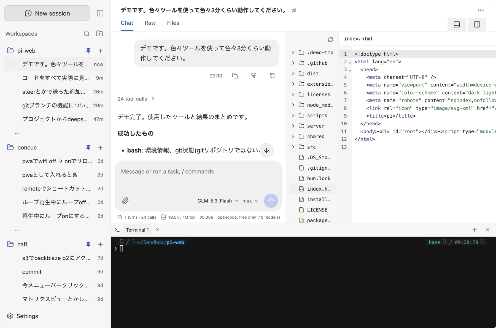
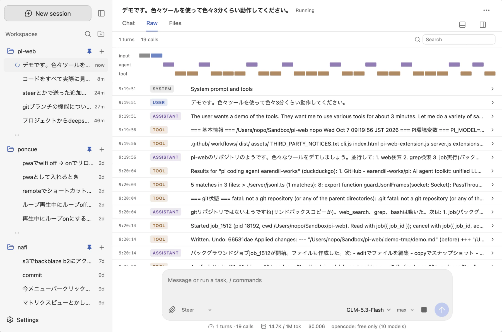
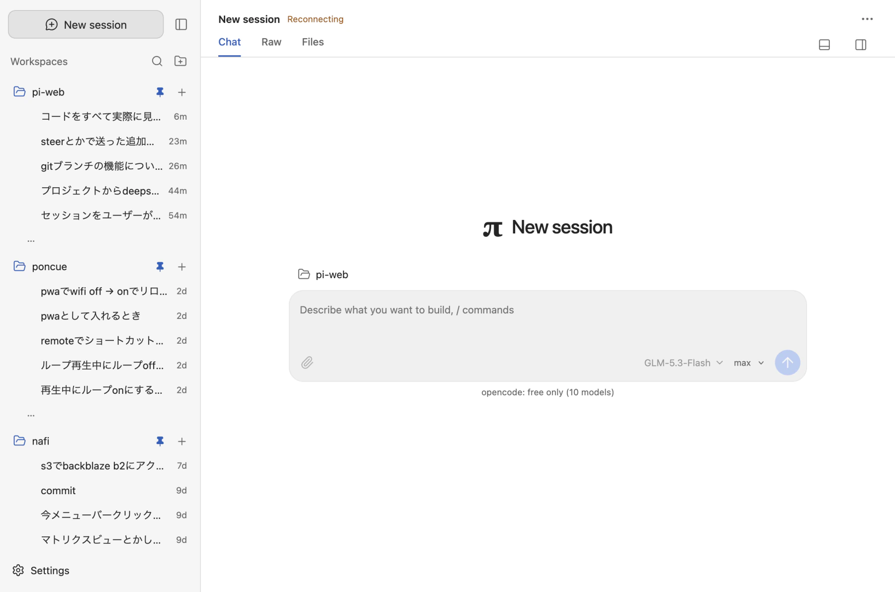
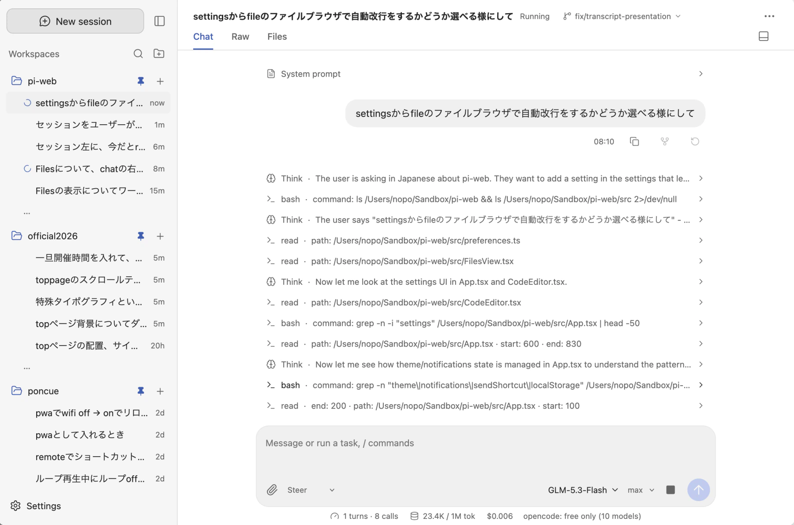

# pi-webui

AI コーディングエージェント [pi](https://pi.dev) のローカル Web UI です。ブラウザからのセッション操作、ファイル編集・Git差分、内蔵ターミナル、CLIとのリアルタイム同期を提供します。

## スクリーンショット

<table width="100%">
  <tr>
    <td width="50%"><a href="screenshots/screen3.webp"></a></td>
    <td width="50%"><a href="screenshots/screen4.webp"></a></td>
  </tr>
  <tr>
    <td width="50%"><a href="screenshots/screen1.webp"></a></td>
    <td width="50%"><a href="screenshots/screen2.webp"></a></td>
  </tr>
</table>

## 前提条件

- **[pi](https://pi.dev)**: `npm i -g @earendil-works/pi-coding-agent`（初回認証・設定が必要）
- **[Bun](https://bun.sh)**: 1.3.14 以降

## インストールと起動

```sh
git clone https://github.com/noponoponopo/pi-webui.git && cd pi-webui
./install.sh

# Web UI を開く (~/.local/bin を PATH に追加)
pi-webui
```
